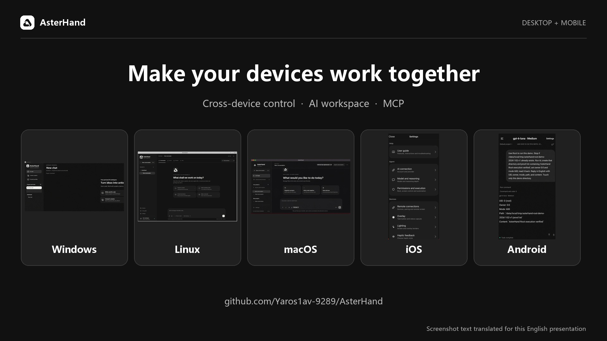
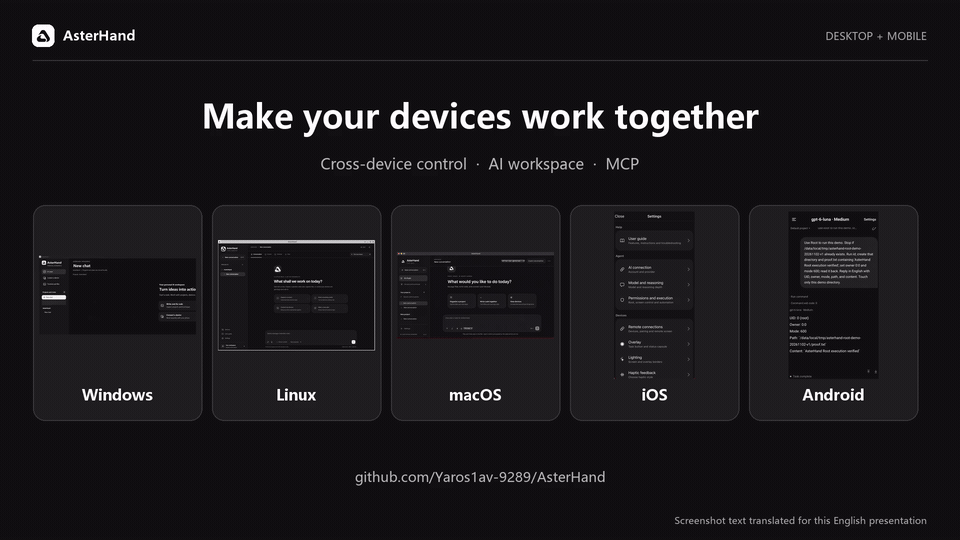
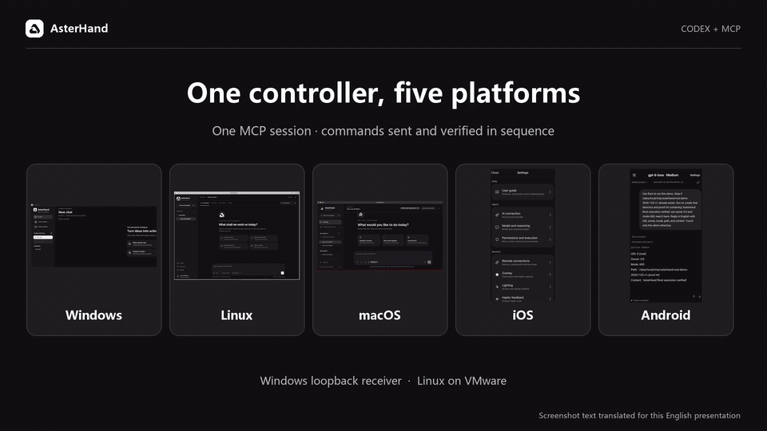

<p align="center">
  
</p>

<h1 align="center">AsterHand</h1>
<p align="center"><strong>Cross-device Root control. Local device agents.</strong></p>
<p align="center">
  <a href="#start-in-four-steps"><kbd>Get started</kbd></a>
  <a href="#windows"><kbd>Windows</kbd></a>
  <a href="#macos"><kbd>macOS</kbd></a>
  <a href="#linux"><kbd>Linux</kbd></a>
  <a href="#android"><kbd>Android</kbd></a>
  <a href="#ios"><kbd>iOS</kbd></a>
  <a href="#mcp"><kbd>MCP</kbd></a>
  <a href="#watch-it-work"><kbd>Videos</kbd></a>
</p>
<p align="center">
  <a href="README.md">English</a> ·
  <a href="README.zh-CN.md">简体中文</a> ·
  <a href="https://yaroslav830.github.io/AsterHand/">Website</a>
</p>

AsterHand brings the Root-authorized tools of paired Android and compatible jailbroken iOS devices into one encrypted workflow, alongside local AI workspaces, files and terminals on desktop and mobile. Connect your own ChatGPT account or OpenAI-compatible API, choose a project and an execution target, and let the agent use the tools you authorize.

**Build 82 is a preview.** Android and iOS display version 1.0; Windows remains 0.1 testing, macOS 0.1.4 and Linux 0.1.0. Individual tools depend on the operating system and receiver permissions.



Screenshot text has been translated for this English presentation.

## What you can do

- **Work with an agent:** projects, separate conversations, model selection, reasoning settings, attachments and tool progress.
- **Control another device:** LAN discovery, pairing requests, screen viewing and authorized taps, swipes or desktop input.
- **Use files and terminals:** local or remote commands, persistent terminal sessions and file operations.
- **Use device privileges:** Android Standard / ADB / Root tiers and privileged helpers for compatible jailbroken iOS.
- **Connect your AI assistant:** 22 MCP tools share the device protocol; the compact Skill supplies operating rules.
- **Use a familiar interface:** light and dark themes and Chinese, English, Japanese, Spanish and French UI.

Pairing and permissions are separate. Root, ADB, accessibility, screen recording and microphone access remain controlled by the receiving system. Features such as system overlays and continuous voice conversations vary by platform.

## Start in four steps

1. **Install the client.** Select your platform at the top of this page and follow its installation steps.
2. **Connect AI.** Open **Settings → AI Connection** and complete ChatGPT authorization or enter your OpenAI-compatible HTTPS endpoint and API key. Save, then choose a model under **Model & Reasoning** and send a test message.
3. **Pair devices.** Enable remote connections on both clients and make sure they can reach each other on the LAN. Search for the device, enter its pairing code or send a request by IP address. On the receiver, verify the request and choose **Allow once**, **Always allow** or **Reject**.
4. **Run your first task.** Select a project, a conversation and the local or paired execution target. Start with “List the files in this project without changing anything.” Inspect the target screen before sending input. Grant screen and execution permissions on the receiver as needed.

If a device is missing from discovery, check that both clients have remote connections enabled, that the network allows the devices to reach each other and that the apps have local network access. You can disconnect or revoke pairing from the remote connection settings.

Projects and conversations stay on the device. Messages, attachments and required tool results are sent to the selected AI service. A local agent executes tools locally; it does not imply a bundled offline model.

## Watch it work

### Product overview · 26 s



### One MCP controller, five platforms · 26 s



The demonstration presents reviewed real-device screenshots and actual command responses in sequence. The Windows receiver is an isolated instance on the same PC, and Linux runs in VMware.

<a name="download-for-your-platform"></a>

## Platform projects

Find all ten client packages in the [build 82 release](https://github.com/yaroslav830/AsterHand/releases/tag/v1.0-build82-monorepo). Download the matching OS, processor or jailbreak environment.

### Windows

Native desktop workspace, controller, receiver and local tools.

- **Downloads** — [Installer EXE](https://github.com/yaroslav830/AsterHand/releases/download/v1.0-build82-monorepo/AsterHand-Windows-Setup.exe) · [Portable EXE](https://github.com/yaroslav830/AsterHand/releases/download/v1.0-build82-monorepo/AsterHand-Windows.exe)

Run `AsterHand-Windows-Setup.exe` for a per-user installation, or keep `AsterHand-Windows.exe` in a folder and run it directly. The native application requires .NET Framework 4.6.2 or newer and targets Windows 7 SP1 and newer. No separate Electron or Node.js installation is required to launch the Windows client.

### macOS

Intel / Apple silicon desktop agent and device tools.

- **Downloads** — [Intel](https://github.com/yaroslav830/AsterHand/releases/download/v1.0-build82-monorepo/AsterHand-0.1.4-macOS-Intel.zip) · [Apple silicon](https://github.com/yaroslav830/AsterHand/releases/download/v1.0-build82-monorepo/AsterHand-0.1.4-macOS-AppleSilicon.zip)

Choose the Intel ZIP for an Intel Mac or the AppleSilicon ZIP for an Apple silicon Mac. Extract the archive and move AsterHand.app to your preferred application folder.

Intel builds target macOS 10.15+ and Apple silicon builds target macOS 11+. These preview builds use ad hoc signing. If macOS requests confirmation, review the app through Privacy & Security. Screen tools require Screen Recording and Accessibility authorization for this app. A changed application signature may require granting access to the new build again.

### Linux

x64 / arm64 desktop workspace and device tools.

- **Downloads** — [x64 / amd64 DEB](https://github.com/yaroslav830/AsterHand/releases/download/v1.0-build82-monorepo/AsterHand-0.1.0-linux-amd64.deb) · [arm64 DEB](https://github.com/yaroslav830/AsterHand/releases/download/v1.0-build82-monorepo/AsterHand-0.1.0-linux-arm64.deb)
- **Requirements** — Compatible Debian/Ubuntu graphical desktop. Tested on Ubuntu 24.04 x64 in VMware.

Use `uname -m` to check your architecture. Choose amd64 for `x86_64` and arm64 for `aarch64`. Run the following commands on a compatible Debian or Ubuntu desktop.

```sh
sudo apt install ./AsterHand-0.1.0-linux-amd64.deb
asterhand
```

For arm64, replace the filename with `AsterHand-0.1.0-linux-arm64.deb`. Run the GUI as your regular user. Local input injection currently requires X11 and `xdotool`. Screen capture may show a system sharing prompt. Paired phone input follows the phone's permissions.

### Android

Mobile agent, paired control and Standard / ADB / Root tools.

- **Downloads** — [APK](https://github.com/yaroslav830/AsterHand/releases/download/v1.0-build82-monorepo/AsterHand-1.0-Android.apk)

Install `AsterHand-1.0-Android.apk` using your system package installer. The minimum build target is Android 6.0, and this APK uses a development signature.

Choose Standard, ADB or Root in the app. Standard-mode screen assistance needs the appropriate accessibility and system permissions. ADB mode requires authorized debugging. For Root mode, approve the request in the device's existing Root manager. You can open the app in Standard mode.

### iOS

Native app and Rootful / Rootless / RootHide helpers.

- **Downloads** — [Rootful](https://github.com/yaroslav830/AsterHand/releases/download/v1.0-build82-monorepo/AsterHand-1.0-Rootful.deb) · [Rootless](https://github.com/yaroslav830/AsterHand/releases/download/v1.0-build82-monorepo/AsterHand-1.0-Rootless.deb) · [RootHide](https://github.com/yaroslav830/AsterHand/releases/download/v1.0-build82-monorepo/AsterHand-1.0-RootHide.deb)
- **Requirements** — A compatible jailbreak is required. Rootful targets iOS 14+, and Rootless and RootHide target iOS 15+.

#### Install with Sileo or Zebra

1. On the jailbroken device, open Sileo or Zebra and choose **Sources → Add Source**.
2. Enter `https://yaroslav830.github.io/AsterHand/ios-apt/` and refresh. Your package manager selects the matching AsterHand package and resolves dependencies from your existing bootstrap sources.
3. Search for **AsterHand**, review the queue and OpenSSH dependency, then confirm installation. To update, refresh your sources and confirm the upgrade.

For an environment-specific source, run `dpkg --print-architecture` in a device terminal and use the matching address below.

| Environment | dpkg architecture | Source URL |
| --- | --- | --- |
| Rootful / Elucubratus | `iphoneos-arm` | `https://yaroslav830.github.io/AsterHand/ios-apt/rootful/` |
| Rootless | `iphoneos-arm64` | `https://yaroslav830.github.io/AsterHand/ios-apt/rootless/` |
| RootHide | `iphoneos-arm64e` | `https://yaroslav830.github.io/AsterHand/ios-apt/roothide/` |

Procursus Rootful uses the unified source with its existing OpenSSH package.

#### Install from a DEB

Choose the package that matches the active jailbreak environment.

| Environment | File | Minimum firmware |
| --- | --- | --- |
| Rootful | `AsterHand-1.0-Rootful.deb` | iOS 14 |
| Rootless | `AsterHand-1.0-Rootless.deb` | iOS 15 |
| RootHide | `AsterHand-1.0-RootHide.deb` | iOS 15 |

Open the matching DEB in your jailbreak package manager and let it resolve dependencies. All three packages declare OpenSSH.

### MCP

Open the AsterHand desktop control center on Windows, macOS or Linux. MCP reuses the local connection and existing pairings. Android and iOS can act as paired receivers.

1. Prepare Node.js 20+, Python 3.11+, pnpm and the Codex CLI.
2. Get the source and run the installer from the repository root. It registers `asterhand` and preserves your other MCP settings.

   ```sh
   git clone https://github.com/yaroslav830/AsterHand.git
   cd AsterHand
   python scripts/install_asterhand_mcp.py
   ```

3. Start a new Codex conversation and call `devices_list`. Use `device_info` to verify the exact paired device identifier, then inspect the target with `screenshot`. Screen, ADB and Root access are granted by the receiving device owner.

Start with “List my paired AsterHand devices and tell me which ones are online.”

### Verify a download

Download the [SHA-256 checksums](https://github.com/yaroslav830/AsterHand/releases/download/v1.0-build82-monorepo/SHA256SUMS.txt) from the same release. Run the command for your platform and compare the result with the matching line.

```powershell
Get-FileHash .\AsterHand-Windows-Setup.exe -Algorithm SHA256
```

```sh
# macOS
shasum -a 256 AsterHand-0.1.4-macOS-Intel.zip
# Linux
sha256sum AsterHand-0.1.0-linux-amd64.deb
```

Minimum versions describe build targets. The release notes describe the tested configurations and preview limitations. Grant only the tool permissions needed on the receiver.

## Feedback and distribution

[Report a bug](https://github.com/yaroslav830/AsterHand/issues) with the client version, OS, device model, reproduction steps and a redacted screenshot. Keep passwords, keys and private conversations out of reports.

Binaries are distributed through Releases, separately from source branches. The AsterHand source repository is public. Publicly visible source is not granted an open-source license; existing third-party licenses and notices remain in force. See [SOURCE_ONLY.md](SOURCE_ONLY.md).
