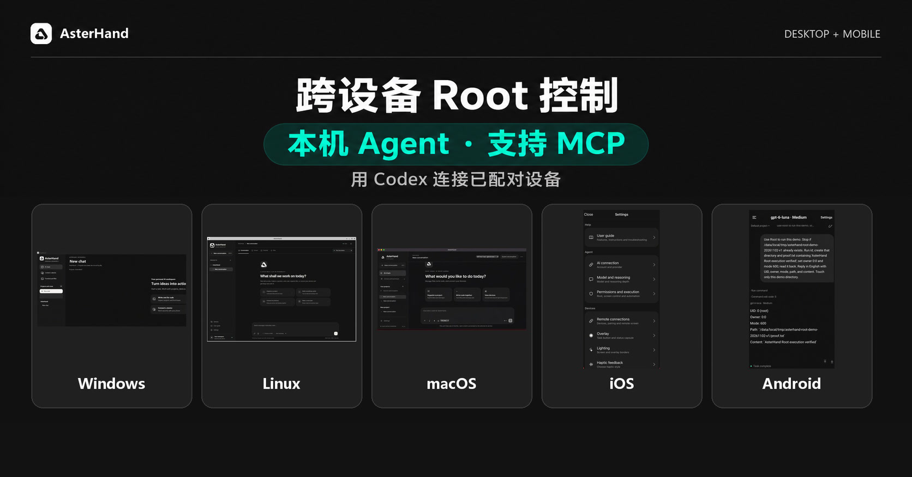

<p align="center">
  
</p>

<h1 align="center">AsterHand</h1>
<p align="center"><strong>跨设备 Root 控制，本机 Agent 协同。</strong></p>
<p align="center">
  <a href="#四步开始"><kbd>初次使用</kbd></a>
  <a href="#windows"><kbd>Windows</kbd></a>
  <a href="#macos"><kbd>macOS</kbd></a>
  <a href="#linux"><kbd>Linux</kbd></a>
  <a href="#android"><kbd>Android</kbd></a>
  <a href="#ios"><kbd>iOS</kbd></a>
  <a href="#mcp"><kbd>MCP</kbd></a>
  <a href="#看看实际效果"><kbd>视频演示</kbd></a>
</p>
<p align="center">
  <a href="README.md">English</a> ·
  <a href="README.zh-CN.md">简体中文</a> ·
  <a href="https://yaroslav830.github.io/AsterHand/?lang=zh">官方网站</a>
</p>

AsterHand 把已配对 Android 和兼容越狱 iOS 的 Root 授权工具带入加密跨设备工作流，并在电脑和手机提供本机 AI 工作区、文件与终端。连接自己的 ChatGPT 账户或 OpenAI 兼容 API，选择项目与执行设备，让智能体使用你已授权的工具完成任务。

**Build 82 为预览版。** Android 与 iOS 显示版本为 1.0，Windows 保持 0.1 测试版，macOS 为 0.1.4，Linux 为 0.1.0。具体工具能力取决于操作系统和接收端权限。



## 可以做什么

- **使用智能体：**管理项目与独立对话，选择模型和推理深度，发送附件，查看工具进度。
- **操控另一台设备：**局域网发现、申请配对、查看屏幕，以及已授权的点击、滑动或桌面输入。
- **操作文件与终端：**本地和远程命令、持续终端会话，以及文件管理。
- **调用设备权限：**Android 普通用户 / ADB / Root 三级执行，兼容越狱 iOS 的高权限辅助服务。
- **连接 AI 助手：**22 个 MCP 工具复用设备协议，精简 Skill 提供操作规范。
- **使用统一界面：**浅色、深色主题，以及中文、英文、日文、西班牙文和法文界面。

配对与权限分别管理。Root、ADB、辅助功能、屏幕录制和麦克风仍由接收端系统授权。系统悬浮窗、连续语音等功能因平台而异。

## 看看实际效果

### 产品介绍 · 26 秒

<!-- Attach MP4: AsterHand-Five-Platforms-Promo-ZH-1080p.mp4 -->

### 一个 MCP 控制端，五个平台 · 26 秒

<!-- Attach MP4: AsterHand-Five-Platforms-MCP-Demo-ZH-1080p.mp4 -->

演示依次展示已审阅的实机截图和实际命令返回结果。Windows 接收端为同一电脑上的隔离实例，Linux 运行在 VMware 中。

## 反馈与发行

[反馈问题](https://github.com/yaroslav830/AsterHand/issues)时请附客户端版本、系统、机型、复现步骤及已去除隐私的截图；不要上传密码、密钥或私有对话。

安装包放在 Releases，与源码分支分别管理。AsterHand 源码仓库公开。公开可见的源码未被授予开源许可证，已有第三方许可证和声明继续有效，详见 [SOURCE_ONLY.md](SOURCE_ONLY.md)。

<a name="选择你的平台"></a>
<a name="平台项目"></a>

## 安装与使用教程

[Build 82 发布页](https://github.com/yaroslav830/AsterHand/releases/tag/v1.0-build82-monorepo)提供全部十个客户端文件的下载入口。请按系统、处理器或越狱环境选择。

### Windows

原生桌面工作区、主控、被控与本机工具。

- **安装包**　[安装版 EXE](https://github.com/yaroslav830/AsterHand/releases/download/v1.0-build82-monorepo/AsterHand-Windows-Setup.exe) · [便携版 EXE](https://github.com/yaroslav830/AsterHand/releases/download/v1.0-build82-monorepo/AsterHand-Windows.exe)

1. 确认系统为 Windows 7 SP1 或以上，并具备 .NET Framework 4.6.2 或更高版本。
2. 使用安装版时，运行 `AsterHand-Windows-Setup.exe`，按提示安装到当前用户。使用便携版时，把 `AsterHand-Windows.exe` 放到单独的文件夹并直接打开。
3. 启动客户端，配置 AI 并在本机发一条消息测试。把 Windows 用作 MCP 控制中心时，保持桌面客户端运行，并使用同一个系统用户启动 Agent。

### macOS

Intel / Apple 芯片桌面 Agent 与设备工具。

- **安装包**　[Intel](https://github.com/yaroslav830/AsterHand/releases/download/v1.0-build82-monorepo/AsterHand-0.1.4-macOS-Intel.zip) · [Apple 芯片](https://github.com/yaroslav830/AsterHand/releases/download/v1.0-build82-monorepo/AsterHand-0.1.4-macOS-AppleSilicon.zip)

1. 在 **关于本机** 中确认处理器。Intel Mac 选择 Intel ZIP，系统要求 macOS 10.15 或以上。Apple 芯片 Mac 选择 AppleSilicon ZIP，系统要求 macOS 11 或以上。
2. 解压后将 `AsterHand.app` 移到“应用程序”并打开。预览包使用临时签名。系统要求确认时，可在 **隐私与安全性** 核对应用。
3. 需要查看屏幕时，在 **隐私与安全性** 为 AsterHand 开启 **屏幕录制**。需要发送触控或输入时，开启 **辅助功能**。更新后如果应用签名变更，检查新版的授权状态。

### Linux

x64 / arm64 桌面工作区与设备工具。

- **安装包**　[x64 / amd64 DEB](https://github.com/yaroslav830/AsterHand/releases/download/v1.0-build82-monorepo/AsterHand-0.1.0-linux-amd64.deb) · [arm64 DEB](https://github.com/yaroslav830/AsterHand/releases/download/v1.0-build82-monorepo/AsterHand-0.1.0-linux-arm64.deb)
- **系统要求**　兼容的 Debian / Ubuntu 图形桌面；已在 VMware Ubuntu 24.04 x64 验证。

在兼容的 Debian 或 Ubuntu 图形桌面中打开终端。用 `uname -m` 确认架构，`x86_64` 选 amd64，`aarch64` 选 arm64。先进入下载 DEB 的目录，再执行安装和启动命令。

```sh
sudo apt install ./AsterHand-0.1.0-linux-amd64.deb
asterhand
```

arm64 将文件名换为 `AsterHand-0.1.0-linux-arm64.deb`。用普通用户运行图形客户端。X11 本机输入需要 `xdotool`；Wayland 目前不支持本机输入注入，截图可能显示系统共享选择框。操作已配对手机时遵循手机自身权限。

### Android

手机 Agent、配对控制及普通用户 / ADB / Root 工具。

- **安装包**　[APK](https://github.com/yaroslav830/AsterHand/releases/download/v1.0-build82-monorepo/AsterHand-1.0-Android.apk)

1. 用系统安装器打开 `AsterHand-1.0-Android.apk` 并完成安装。最低构建目标为 Android 6.0，APK 使用开发签名。
2. 打开 **设置 → 权限等级**，按需选择普通用户、ADB 或 Root。可先从普通用户开始。使用普通模式的屏幕助手时，在系统设置中开启 AsterHand 辅助功能。该模式下，手势需要 Android 7 或以上，截图需要 Android 11 或以上。
3. 使用 ADB 时，从已授权的电脑完成调试激活，然后回到应用确认执行等级。使用 Root 时，在设备已有的 Root 管理器中批准请求。根据用途开启独立的 AI 屏幕控制或远程屏幕权限。

### iOS

原生应用与 Rootful / Rootless / RootHide 辅助服务。

- **安装包**　[Rootful](https://github.com/yaroslav830/AsterHand/releases/download/v1.0-build82-monorepo/AsterHand-1.0-Rootful.deb) · [Rootless](https://github.com/yaroslav830/AsterHand/releases/download/v1.0-build82-monorepo/AsterHand-1.0-Rootless.deb) · [RootHide](https://github.com/yaroslav830/AsterHand/releases/download/v1.0-build82-monorepo/AsterHand-1.0-RootHide.deb)
- **系统要求**　需要兼容越狱。Rootful 最低构建目标为 iOS 14，Rootless 和 RootHide 为 iOS 15。

#### 通过 Sileo 或 Zebra 安装

1. 在越狱设备上打开 Sileo 或 Zebra，进入 **软件源 → 添加软件源**。
2. 输入 `https://yaroslav830.github.io/AsterHand/ios-apt/` 并刷新。软件包管理器会按当前越狱环境选择 AsterHand。这个地址使用现有越狱软件源解析依赖。
3. 搜索 **AsterHand**，检查安装队列和 OpenSSH 依赖，确认安装。以后在包管理器里刷新软件源并确认升级。

如果需要单独的软件源，在设备终端运行 `dpkg --print-architecture`，按下表复制对应地址。

| 越狱环境 | dpkg 架构 | 软件源地址 |
| --- | --- | --- |
| Rootful / Elucubratus | `iphoneos-arm` | `https://yaroslav830.github.io/AsterHand/ios-apt/rootful/` |
| Rootless | `iphoneos-arm64` | `https://yaroslav830.github.io/AsterHand/ios-apt/rootless/` |
| RootHide | `iphoneos-arm64e` | `https://yaroslav830.github.io/AsterHand/ios-apt/roothide/` |

Procursus Rootful 使用统一地址，并保留当前越狱环境的 OpenSSH。

#### 从 DEB 安装

按当前越狱环境选择安装包。

| 环境 | 文件 | 最低固件 |
| --- | --- | --- |
| Rootful | `AsterHand-1.0-Rootful.deb` | iOS 14 |
| Rootless | `AsterHand-1.0-Rootless.deb` | iOS 15 |
| RootHide | `AsterHand-1.0-RootHide.deb` | iOS 15 |

用越狱包管理器打开对应 DEB，并由包管理器处理依赖。三个包均声明 OpenSSH 依赖。安装后打开 AsterHand 并连接 AI 服务。在 **设置 → 权限与执行** 中检查本机 Root 和 AI 屏幕控制的独立开关。远程屏幕权限在 **远程连接** 中管理。

### MCP

在 Windows、macOS 或 Linux 上打开 AsterHand 桌面控制中心。MCP 复用本机连接和已有配对，iOS 和 Android 可作为配对的接收端。

1. 准备 Node.js 20+、Python 3.11+、pnpm 和 Codex CLI。
2. 获取源码，在仓库根目录运行安装命令。安装器会注册 `asterhand` 并保留其他 MCP 配置。

   ```sh
   git clone https://github.com/yaroslav830/AsterHand.git
   cd AsterHand
   python scripts/install_asterhand_mcp.py
   ```

3. 在终端运行 `codex mcp list`，确认列表中有 `asterhand`。保持桌面客户端运行，然后新建 Codex 会话加载工具。
4. 调用 `devices_list` 查看设备。用 `device_info` 核对配对设备的准确标识，再用 `screenshot` 查看目标屏幕。需要交互时，先核对接收端的屏幕和执行权限。

安装器未找到 pnpm 时，可在仓库根目录安装锁定的依赖，再重新运行安装器。

```sh
pnpm --dir mcp install --frozen-lockfile --ignore-scripts
python scripts/install_asterhand_mcp.py --skip-dependencies
```

如果使用其他 MCP 客户端，在客户端中配置本机 stdio 服务。命令填写 Node.js 的绝对路径，参数填写 `mcp/server.mjs` 的绝对路径，并把环境变量 `ASTERHAND_HOME` 设为本仓库的绝对路径。

你可以从“列出已配对的 AsterHand 设备，告诉我哪些设备在线”开始。

### 校验安装包

从同一发布页下载 [SHA-256 校验文件](https://github.com/yaroslav830/AsterHand/releases/download/v1.0-build82-monorepo/SHA256SUMS.txt)。运行对应平台的命令，将结果与校验文件的对应行比较。

```powershell
Get-FileHash .\AsterHand-Windows-Setup.exe -Algorithm SHA256
```

```sh
# macOS
shasum -a 256 AsterHand-0.1.4-macOS-Intel.zip
# Linux
sha256sum AsterHand-0.1.0-linux-amd64.deb
```

最低系统版本是构建目标，不代表所有机型与系统组合均已验证。预览版限制见发布说明，在接收端开启实际需要的工具权限即可。

### 四步开始

1. **安装客户端。** 点击本页顶部的平台按钮，按系统、处理器和越狱环境选择安装包。完成安装后打开 AsterHand。
2. **连接 AI。** 打开 **设置 → AI 连接**。选择 ChatGPT 登录并在授权页面完成操作，或填写兼容服务商提供的 HTTPS 地址和 API Key。保存后进入 **模型与推理**，获取可用模型，选择模型或填写模型 ID，再发一条简单消息测试。
3. **新建项目和对话。** 从首页进入项目管理，新建或选择项目，再打开对话并选择执行设备。模型和服务支持时，可通过附件按钮选择图片或文件。先在本机试一句“列出当前项目的文件，先不要修改内容”。
4. **配对并使用另一台设备。** 按下面的步骤完成配对，将执行目标切换到对应设备。发送触控或文字前，先查看屏幕确认目标。屏幕、ADB 或 Root 权限按需要在接收端单独授予。

### 配对手机与电脑

1. 在两台设备上打开 AsterHand，在 **设置 → 远程连接** 中启用服务，确保设备之间网络互通。
2. 在控制端搜索接收设备。未找到时，可输入配对码或接收端 IP 发起请求。在接收端检查请求，确认发起方身份。
3. 临时操作选 **允许一次**，需长期使用可选 **始终允许**。遇到未知请求时选 **拒绝**。之后可在远程连接设置中断开会话或撤销配对。
4. 进入已配对设备页面，先试着查看截图并核对目标屏幕。屏幕输入、文件、终端和高权限工具由接收端单独授权。遇到操作确认时，先查看任务内容再决定是否放行。

项目和对话保存在设备本机，消息、附件和推理需要的工具结果会发送到所选 AI 服务。停止任务会中止后续操作，已完成的操作仍然有效。

### 常见问题

| 现象 | 排查方法 |
| --- | --- |
| ChatGPT 登录或加载模型失败 | 检查网络和账号状态，再打开授权页重新选择账户或工作区。使用兼容 API 时，核对 HTTPS 地址、模型 ID 和密钥的模型权限。 |
| 搜不到另一台设备 | 在接收端打开 AsterHand，确认远程连接服务已开启，应用拥有局域网访问权限。检查两端能否互通，再尝试输入配对码或 IP。 |
| 配对成功但无法截图或输入 | 检查接收端的屏幕权限和执行等级。macOS 检查屏幕录制和辅助功能，Android 检查执行等级和远程屏幕开关，iOS 在远程连接设置中检查远程屏幕权限。 |
| 休眠或重启后服务中断 | 回到接收端应用检查服务状态。需要继续中断的任务时，先核对当前设备状态，再手动继续。 |
| MCP 已启动但看不到接收端 | 保持桌面控制中心运行，确认它与 MCP 客户端使用同一个系统用户。检查应用中的配对列表，再打开新的 Agent 会话。 |
