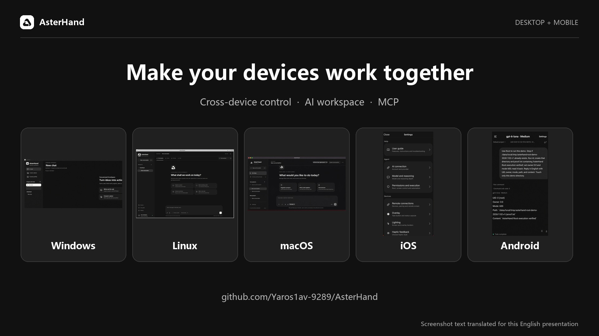
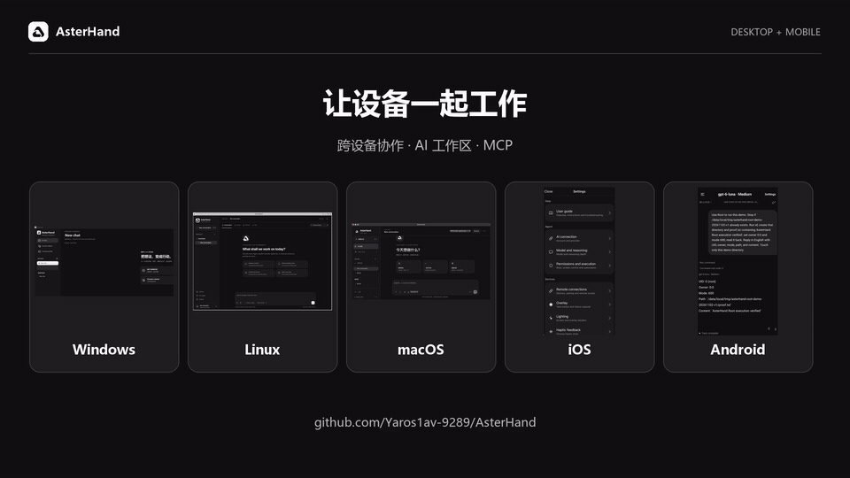
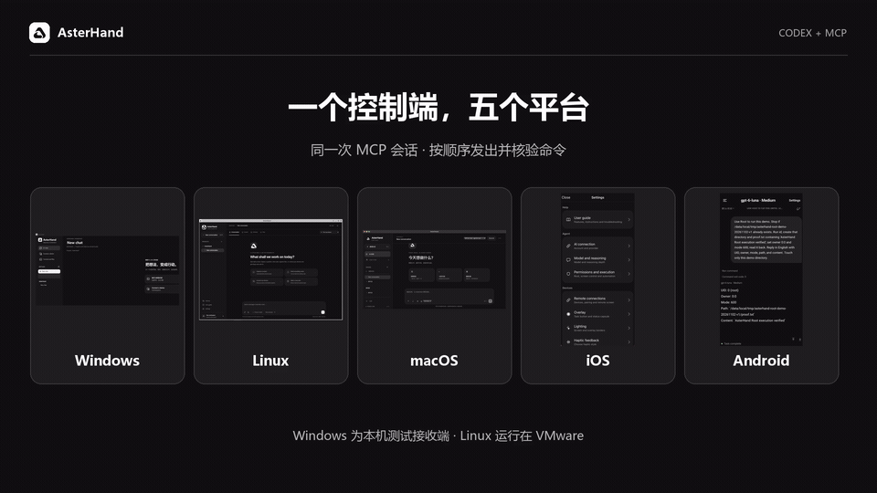

<p align="center">
  
</p>

<h1 align="center">AsterHand</h1>
<p align="center"><strong>跨设备 Root 控制，本机 Agent 协同。</strong></p>
<p align="center">
  <a href="#四步开始"><kbd>初次使用</kbd></a>
  <a href="#windows"><kbd>Windows</kbd></a>
  <a href="#macos"><kbd>macOS</kbd></a>
  <a href="#linux"><kbd>Linux</kbd></a>
  <a href="#android"><kbd>Android</kbd></a>
  <a href="#ios"><kbd>iOS</kbd></a>
  <a href="#mcp"><kbd>MCP</kbd></a>
  <a href="#看看实际效果"><kbd>视频演示</kbd></a>
</p>
<p align="center">
  <a href="README.md">English</a> ·
  <a href="README.zh-CN.md">简体中文</a> ·
  <a href="https://yaroslav830.github.io/AsterHand/?lang=zh">官方网站</a>
</p>

AsterHand 把已配对 Android 和兼容越狱 iOS 的 Root 授权工具带入加密跨设备工作流，并在电脑和手机提供本机 AI 工作区、文件与终端。连接自己的 ChatGPT 账户或 OpenAI 兼容 API，选择项目与执行设备，让智能体使用你已授权的工具完成任务。

**Build 82 为预览版。** Android 与 iOS 显示版本为 1.0，Windows 保持 0.1 测试版，macOS 为 0.1.4，Linux 为 0.1.0。具体工具能力取决于操作系统和接收端权限。



## 可以做什么

- **使用智能体：**管理项目与独立对话，选择模型和推理深度，发送附件，查看工具进度。
- **操控另一台设备：**局域网发现、申请配对、查看屏幕，以及已授权的点击、滑动或桌面输入。
- **操作文件与终端：**本地和远程命令、持续终端会话，以及文件管理。
- **调用设备权限：**Android 普通用户 / ADB / Root 三级执行，兼容越狱 iOS 的高权限辅助服务。
- **连接 AI 助手：**22 个 MCP 工具复用设备协议，精简 Skill 提供操作规范。
- **使用统一界面：**浅色、深色主题，以及中文、英文、日文、西班牙文和法文界面。

配对与权限分别管理。Root、ADB、辅助功能、屏幕录制和麦克风仍由接收端系统授权。系统悬浮窗、连续语音等功能因平台而异。

## 四步开始

1. **安装客户端。**点击页面顶部的平台按钮，按对应步骤安装。
2. **连接 AI。**打开 **设置 → AI 连接**，完成 ChatGPT 授权，或填写自己的 OpenAI 兼容 HTTPS 接口和 API Key。保存后在 **模型与推理** 选择模型，先发一条消息测试连接。
3. **配对设备。**在两端启用远程连接，确保设备在局域网内可以互通。通过搜索、配对码或 IP 发出申请。接收端核对请求后选择 **允许一次**、**始终允许** 或 **拒绝**。
4. **执行第一个任务。**选择项目、对话和本机或已配对的执行设备。可以从“列出当前项目的文件，先不要修改内容”开始。发送触控或文字前先查看目标屏幕，并按需要在接收端授予屏幕和执行权限。

搜不到设备时，检查两端是否开启远程连接、网络是否互通，以及应用是否拥有局域网权限。可以在远程连接设置中断开或撤销配对。

项目和对话保存在设备本机；消息、附件和推理需要的工具结果会发送到所选 AI 服务。“本机 Agent”指在本机执行工具，不表示内置离线模型。

## 看看实际效果

### 产品介绍 · 26 秒



### 一个 MCP 控制端，五个平台 · 26 秒



演示依次展示已审阅的实机截图和实际命令返回结果。Windows 接收端为同一电脑上的隔离实例，Linux 运行在 VMware 中。

<a name="选择你的平台"></a>

## 平台项目

[Build 82 发布页](https://github.com/yaroslav830/AsterHand/releases/tag/v1.0-build82-monorepo)提供全部十个客户端文件的下载入口。请按系统、处理器或越狱环境选择。

### Windows

原生桌面工作区、主控、被控与本机工具。

- **安装包**　[安装版 EXE](https://github.com/yaroslav830/AsterHand/releases/download/v1.0-build82-monorepo/AsterHand-Windows-Setup.exe) · [便携版 EXE](https://github.com/yaroslav830/AsterHand/releases/download/v1.0-build82-monorepo/AsterHand-Windows.exe)

运行 `AsterHand-Windows-Setup.exe` 安装到当前用户，或把 `AsterHand-Windows.exe` 放在一个文件夹中直接运行。原生客户端最低构建目标为 Windows 7 SP1，需要 .NET Framework 4.6.2 或更高版本；启动 Windows 客户端不需另装 Electron 或 Node.js。

### macOS

Intel / Apple 芯片桌面 Agent 与设备工具。

- **安装包**　[Intel](https://github.com/yaroslav830/AsterHand/releases/download/v1.0-build82-monorepo/AsterHand-0.1.4-macOS-Intel.zip) · [Apple 芯片](https://github.com/yaroslav830/AsterHand/releases/download/v1.0-build82-monorepo/AsterHand-0.1.4-macOS-AppleSilicon.zip)

Intel Mac 选择 Intel ZIP，Apple 芯片 Mac 选择 AppleSilicon ZIP。解压后把 AsterHand.app 移到准备存放应用的位置。

Intel 版最低目标 macOS 10.15，Apple 芯片版为 macOS 11。这些预览包使用临时签名，尚未公证；若系统要求确认，请在常规“隐私与安全性”页面核对应用。使用屏幕工具需为此应用授予屏幕录制与辅助功能权限；应用签名变化后可能需要重新授权新版。

### Linux

x64 / arm64 桌面工作区与设备工具。

- **安装包**　[x64 / amd64 DEB](https://github.com/yaroslav830/AsterHand/releases/download/v1.0-build82-monorepo/AsterHand-0.1.0-linux-amd64.deb) · [arm64 DEB](https://github.com/yaroslav830/AsterHand/releases/download/v1.0-build82-monorepo/AsterHand-0.1.0-linux-arm64.deb)
- **系统要求**　兼容的 Debian / Ubuntu 图形桌面；已在 VMware Ubuntu 24.04 x64 验证。

先用 `uname -m` 确认架构。`x86_64` 选 amd64，`aarch64` 选 arm64。在兼容的 Debian 或 Ubuntu 图形桌面中执行以下命令。

```sh
sudo apt install ./AsterHand-0.1.0-linux-amd64.deb
asterhand
```

arm64 将文件名换为 `AsterHand-0.1.0-linux-arm64.deb`。用普通用户运行图形客户端。X11 本机输入需要 `xdotool`；Wayland 目前不支持本机输入注入，截图可能显示系统共享选择框。操作已配对手机时遵循手机自身权限。

### Android

手机 Agent、配对控制及普通用户 / ADB / Root 工具。

- **安装包**　[APK](https://github.com/yaroslav830/AsterHand/releases/download/v1.0-build82-monorepo/AsterHand-1.0-Android.apk)

使用系统安装器安装 `AsterHand-1.0-Android.apk`。最低构建目标 Android 6.0，当前 APK 使用开发签名。

在应用中选择普通用户、ADB 或 Root。普通模式的屏幕助手需相应的辅助功能和系统授权；ADB 需调试授权；Root 需在设备已有的 Root 管理器中允许。仅打开应用不要求 Root。

### iOS

原生应用与 Rootful / Rootless / RootHide 辅助服务。

- **安装包**　[Rootful](https://github.com/yaroslav830/AsterHand/releases/download/v1.0-build82-monorepo/AsterHand-1.0-Rootful.deb) · [Rootless](https://github.com/yaroslav830/AsterHand/releases/download/v1.0-build82-monorepo/AsterHand-1.0-Rootless.deb) · [RootHide](https://github.com/yaroslav830/AsterHand/releases/download/v1.0-build82-monorepo/AsterHand-1.0-RootHide.deb)
- **系统要求**　需要兼容越狱。Rootful 最低构建目标为 iOS 14，Rootless 和 RootHide 为 iOS 15。

#### 通过 Sileo 或 Zebra 安装

1. 在越狱设备上打开 Sileo 或 Zebra，进入 **软件源 → 添加软件源**。
2. 输入 `https://yaroslav830.github.io/AsterHand/ios-apt/` 并刷新。软件包管理器会按当前越狱环境选择 AsterHand。这个地址使用现有越狱软件源解析依赖。
3. 搜索 **AsterHand**，检查安装队列和 OpenSSH 依赖，确认安装。以后在包管理器里刷新软件源并确认升级。

如果需要单独的软件源，在设备终端运行 `dpkg --print-architecture`，按下表复制对应地址。

| 越狱环境 | dpkg 架构 | 软件源地址 |
| --- | --- | --- |
| Rootful / Elucubratus | `iphoneos-arm` | `https://yaroslav830.github.io/AsterHand/ios-apt/rootful/` |
| Rootless | `iphoneos-arm64` | `https://yaroslav830.github.io/AsterHand/ios-apt/rootless/` |
| RootHide | `iphoneos-arm64e` | `https://yaroslav830.github.io/AsterHand/ios-apt/roothide/` |

Procursus Rootful 使用统一地址，并保留当前越狱环境的 OpenSSH。

#### 从 DEB 安装

按当前越狱环境选择安装包。

| 环境 | 文件 | 最低固件 |
| --- | --- | --- |
| Rootful | `AsterHand-1.0-Rootful.deb` | iOS 14 |
| Rootless | `AsterHand-1.0-Rootless.deb` | iOS 15 |
| RootHide | `AsterHand-1.0-RootHide.deb` | iOS 15 |

用越狱包管理器打开对应 DEB，并由包管理器处理依赖。三个包均声明 OpenSSH 依赖，需要匹配的越狱环境，不支持未越狱 iOS。

### MCP

在 Windows、macOS 或 Linux 上打开 AsterHand 桌面控制中心。MCP 复用本机连接和已有配对，iOS 和 Android 可作为配对的接收端。

1. 准备 Node.js 20+、Python 3.11+、pnpm 和 Codex CLI。
2. 获取源码，在仓库根目录运行安装命令。安装器会注册 `asterhand` 并保留其他 MCP 配置。

   ```sh
   git clone https://github.com/yaroslav830/AsterHand.git
   cd AsterHand
   python scripts/install_asterhand_mcp.py
   ```

3. 重新打开 Codex 会话，调用 `devices_list` 列出设备。用 `device_info` 核对配对设备的准确标识，再用 `screenshot` 检查目标屏幕。接收端的屏幕、ADB 和 Root 权限由设备所有者授权。

你可以从“列出已配对的 AsterHand 设备，告诉我哪些设备在线”开始。

### 校验安装包

从同一发布页下载 [SHA-256 校验文件](https://github.com/yaroslav830/AsterHand/releases/download/v1.0-build82-monorepo/SHA256SUMS.txt)。运行对应平台的命令，将结果与校验文件的对应行比较。

```powershell
Get-FileHash .\AsterHand-Windows-Setup.exe -Algorithm SHA256
```

```sh
# macOS
shasum -a 256 AsterHand-0.1.4-macOS-Intel.zip
# Linux
sha256sum AsterHand-0.1.0-linux-amd64.deb
```

最低系统版本是构建目标，不代表所有机型与系统组合均已验证。预览版限制见发布说明，在接收端开启实际需要的工具权限即可。

## 反馈与发行

[反馈问题](https://github.com/yaroslav830/AsterHand/issues)时请附客户端版本、系统、机型、复现步骤及已去除隐私的截图；不要上传密码、密钥或私有对话。

安装包放在 Releases，与源码分支分别管理。AsterHand 源码仓库公开。公开可见的源码未被授予开源许可证，已有第三方许可证和声明继续有效，详见 [SOURCE_ONLY.md](SOURCE_ONLY.md)。
